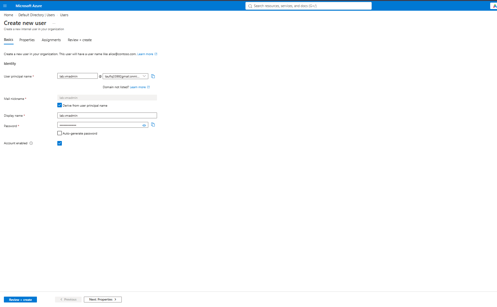
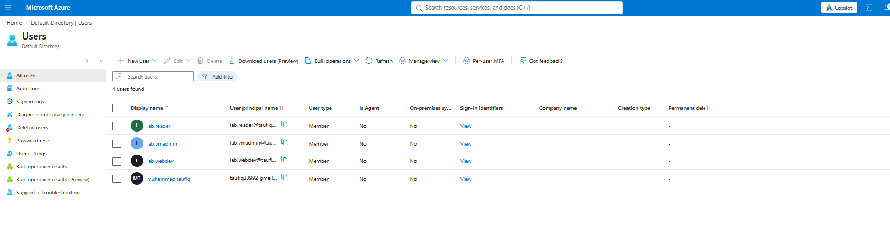
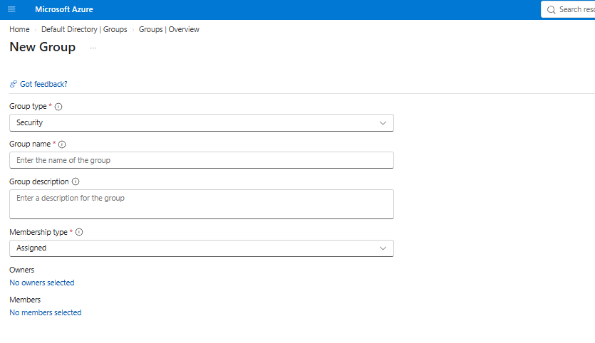
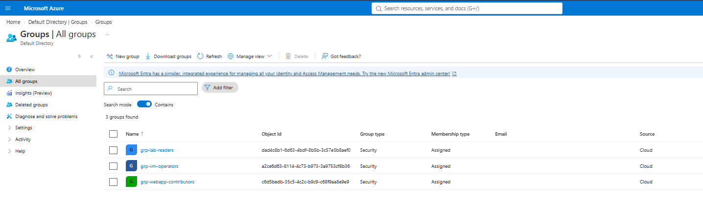
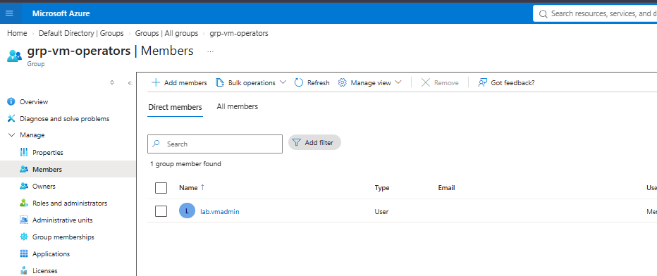
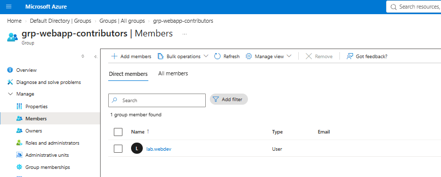
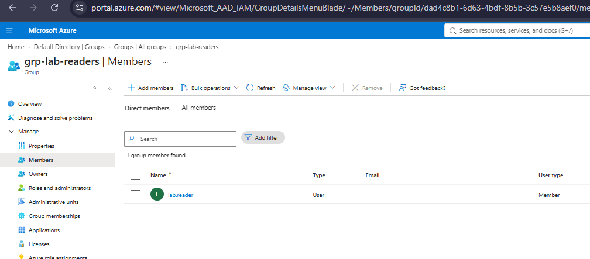

# 01 – Entra Users and Groups

Test identities and security groups used for RBAC, PIM, and access reviews in later projects.

## What I built
- 3 test users in the default Entra ID tenant
- 3 security groups (assigned membership), one user in each

| User | Group | Used for |
|---|---|---|
| `lab.vmadmin` | `grp-vm-operators` | VM access (03) |
| `lab.webdev` | `grp-webapp-contributors` | App Service access (06) |
| `lab.reader` | `grp-lab-readers` | Read-only and denied-access tests |

## Steps
1. Signed in to the Entra admin center
2. Created the three users with temporary passwords
3. Created the three security groups
4. Added each user to its group
5. Verified membership

## Evidence

Creating one of the test users with a temporary password.

All three test users created in the tenant.

Creating a security group with assigned membership.

All three security groups created.

`grp-vm-operators` contains `lab.vmadmin`.

`grp-webapp-contributors` contains `lab.webdev`.

`grp-lab-readers` contains `lab.reader`.

## Exam notes
- Assign roles to groups, not individual users
- Assigned membership: admins add members manually
- Dynamic membership needs Entra ID P1
- Security groups can hold RBAC roles; Microsoft 365 groups are for collaboration

## Used later
- 03: custom RBAC role for `grp-vm-operators`
- 05: PIM eligibility and access reviews on these groups
- 06: Website Contributor role for `grp-webapp-contributors`
