# 02 – Network and Storage

Private network with a locked-down storage account reachable only through a private endpoint.

## What I built
- VNet `vnet-lab` (10.0.0.0/16) in Malaysia West
- Subnets: `snet-resources` (10.0.1.0/24), `snet-privateendpoints` (10.0.2.0/24)
- NSG `nsg-resources` attached to `snet-resources`
- Storage account with public network access disabled
- Private endpoint for Blob, with private DNS zone `privatelink.blob.core.windows.net`
- Exported ARM template: [template.json](template.json)

## Steps
1. Created resource group `rg-lab-network`
2. Created the VNet with two subnets
3. Created the NSG with an RDP rule (my IP only) and a VNet outbound rule, then attached it to the resources subnet
4. Created the storage account with public access disabled
5. Added the private endpoint with DNS integration
6. Verified access from outside the VNet is blocked
7. Exported the ARM template

## Evidence
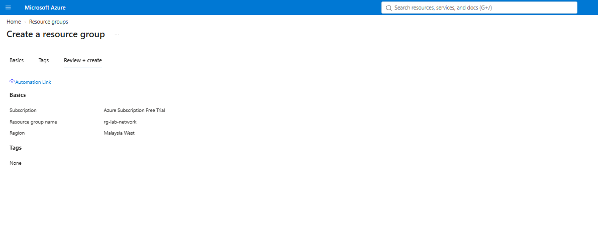
Resource group `rg-lab-network` for the network resources.

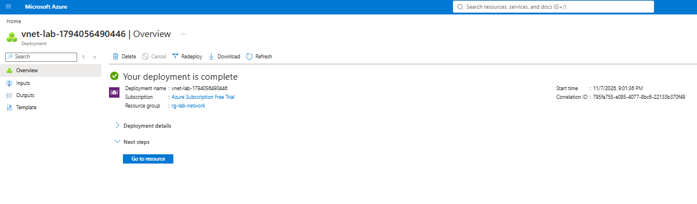
`vnet-lab` deployment completed.

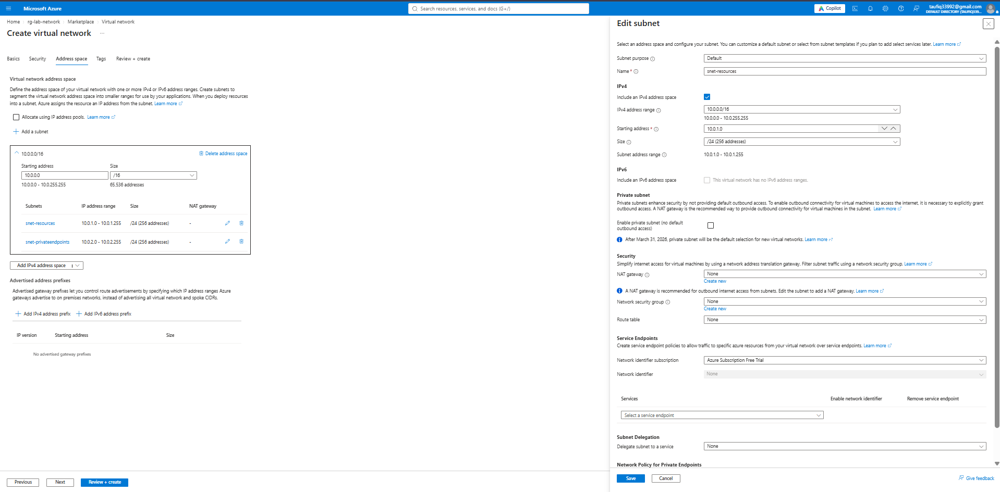
Address space 10.0.0.0/16 with the two subnets.

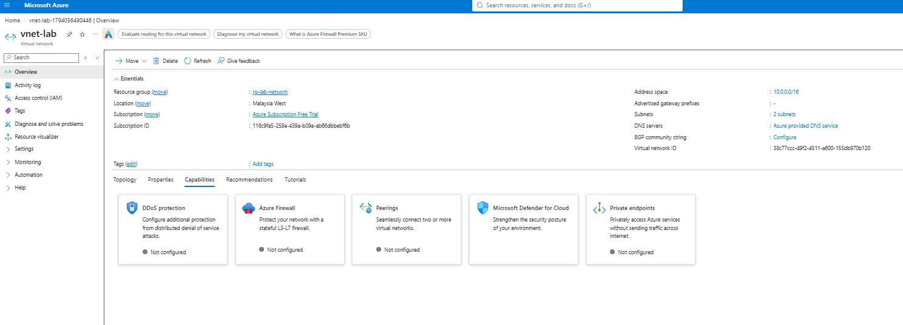
VNet overview showing both subnets.

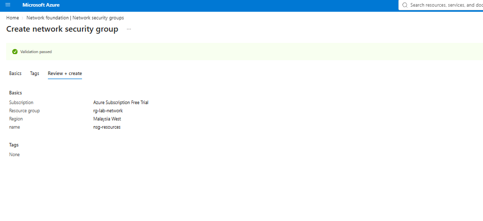
Creating `nsg-resources`.

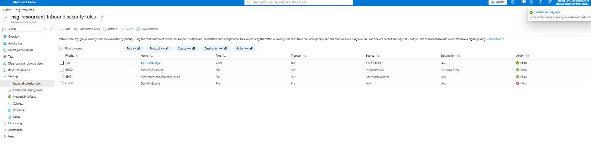
Inbound RDP allowed from one IP only.

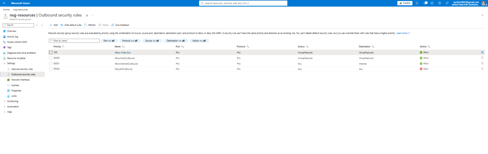
Outbound allowed within the VNet.

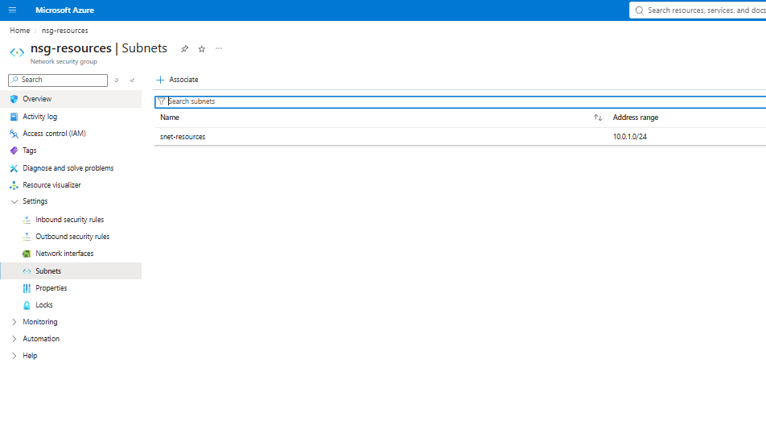
NSG attached to `snet-resources`.

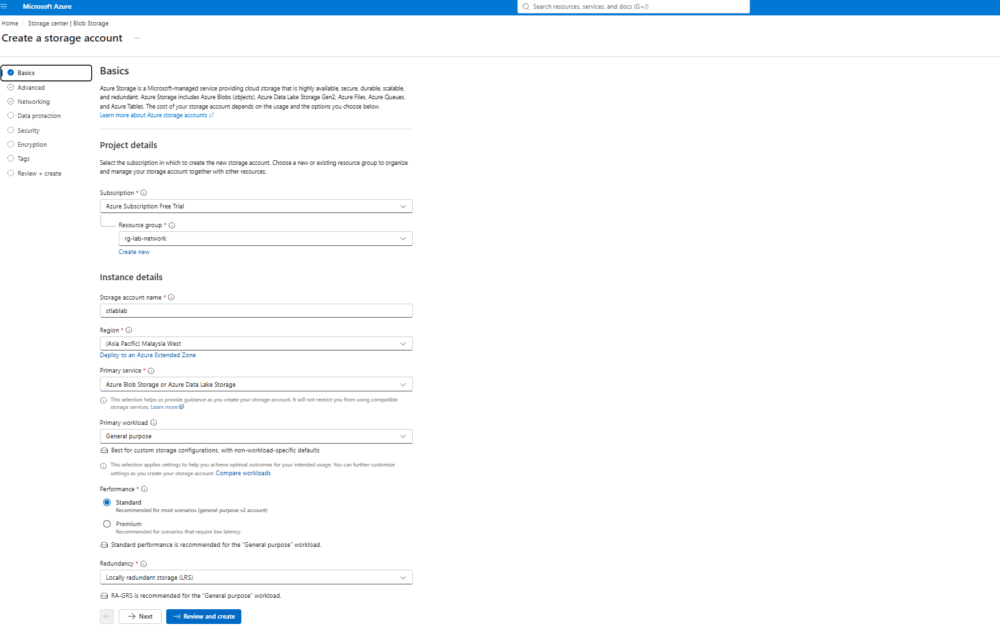
Storage account basics: standard, LRS.

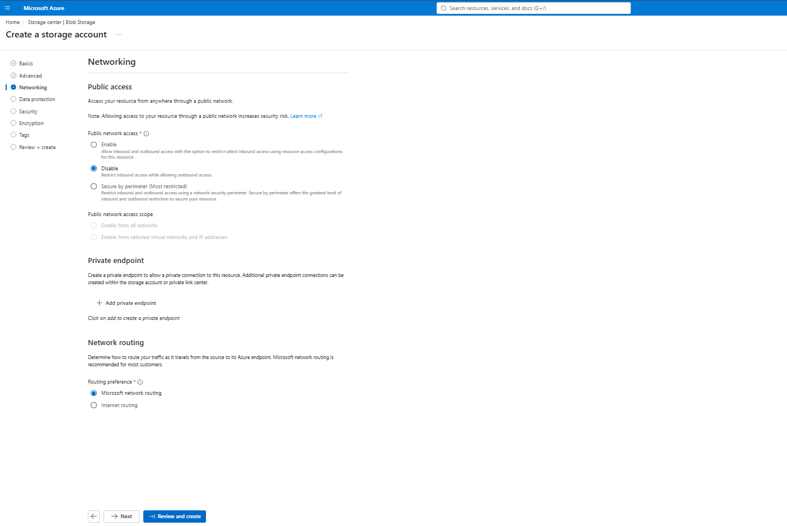
Public network access disabled.

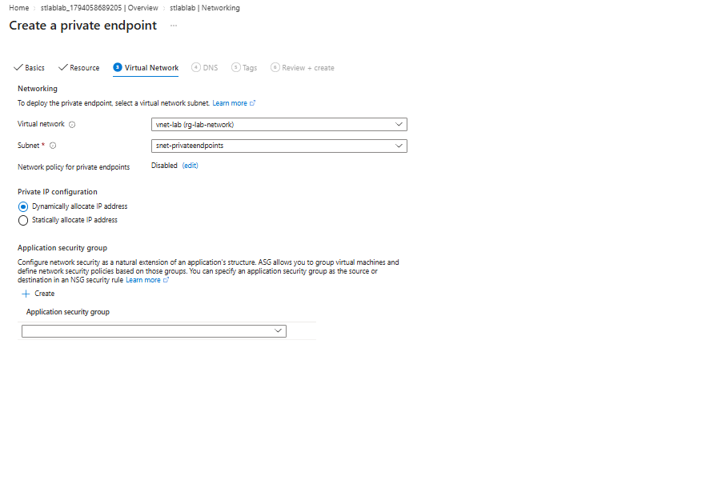
Private endpoint targeting Blob in the endpoints subnet.

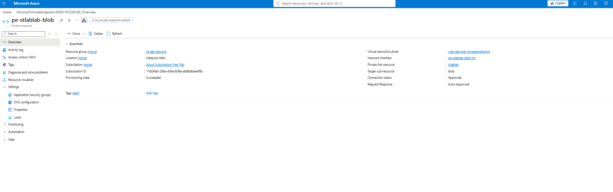
Private endpoint connection approved.

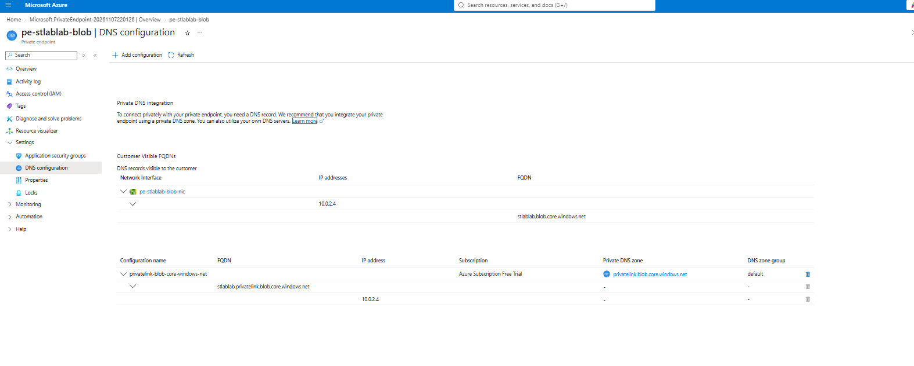
DNS configuration with the storage name mapping to a 10.0.2.x IP.

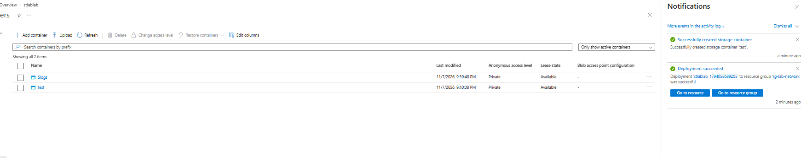
Test blob created in the storage account.

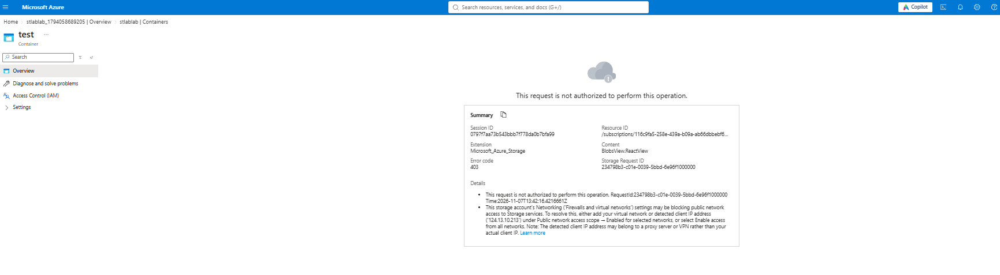
Access from outside the VNet is not authorized.

## Exam notes
- NSG rules: lowest priority number is evaluated first
- NSGs are stateful: replies to allowed traffic are allowed automatically
- A private endpoint needs a private DNS zone linked to the VNet, or the name still resolves to the public IP
- Management-plane actions (list containers) still work with public access disabled; data-plane actions (read blobs) do not
- NSGs attach to subnets or NICs; with both, inbound traffic is checked at the subnet first

## Redeploying
`template.json` is an exported template. Replace `YOUR_PUBLIC_IP` in the RDP rule with your own IP before deploying.
