# 03 – VM and RBAC

Secured Linux VM in the lab network, with least-privilege access, tag enforcement, data disk encryption, and a cost alert.

## What I built
- VM `vm-lab-01`: Ubuntu 24.04, Standard_B2als_v2, Malaysia West, in `snet-resources` of `vnet-lab`
- Custom RBAC role `VM Operator Custom`, assigned to `grp-vm-operators` at VM scope
- Azure Policy `require-env-tag` on `rg-lab-vm` (Deny)
- Azure Disk Encryption on the data disk, with Key Vault `kv-lab-03`
- Budget `budget-lab-monthly` with email alerts
- Role definition: [role-definition.json](role-definition.json)

## Steps
1. Created the VM with a data disk, tags `env=lab` and `project=az104`, and no public inbound ports
2. Added an NSG rule for SSH from my IP only
3. Assigned the tag policy and tested it with an untagged public IP
4. Created the custom role and assigned it to the group at VM scope
5. Tested access as `lab.vmadmin`
6. Created the Key Vault, formatted and mounted the data disk, and enabled ADE
7. Created the budget with actual and forecasted alerts

## Evidence
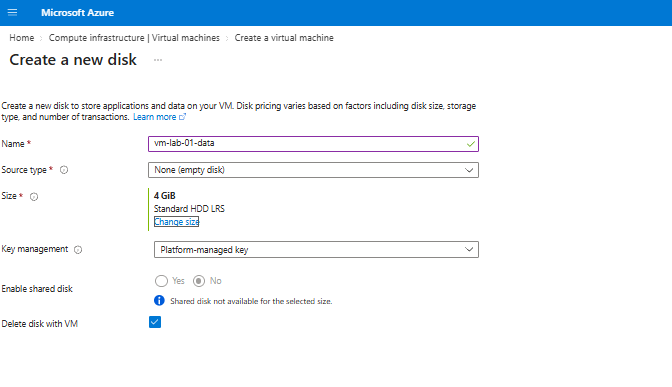
New data disk attached during VM creation.

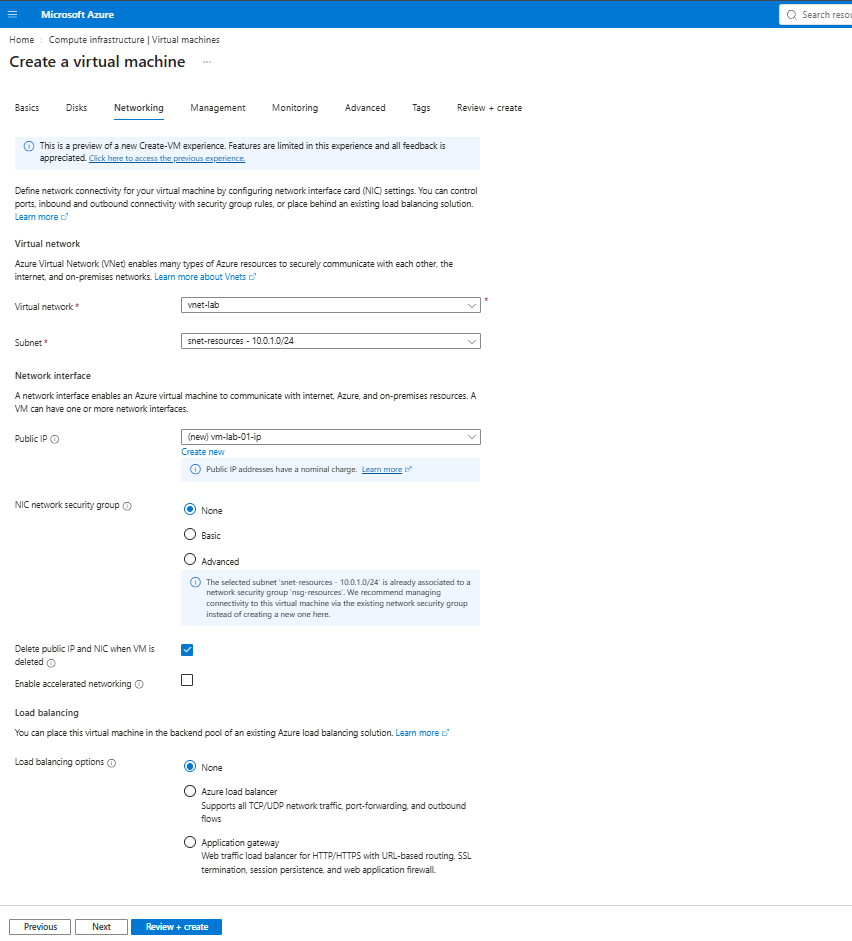
VM creation wizard.

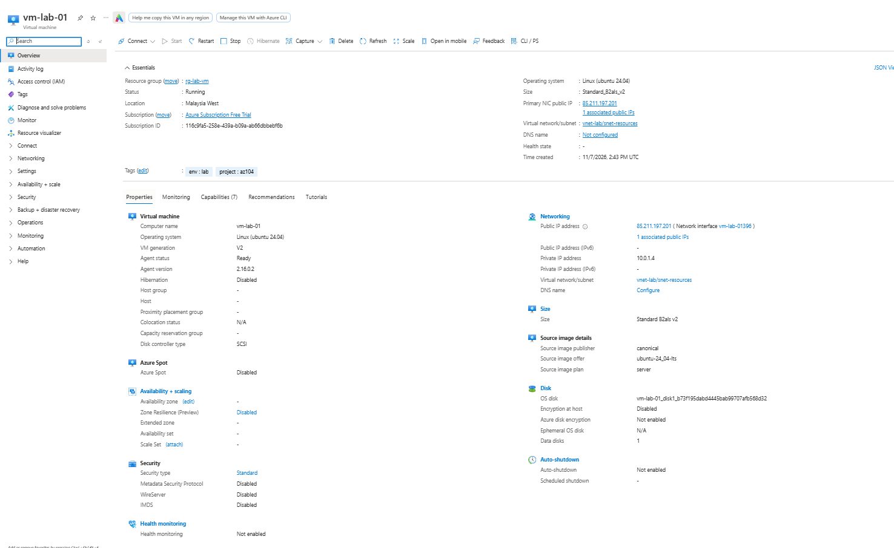
VM running with tags `env=lab` and `project=az104`.

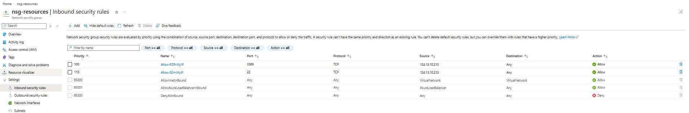
Inbound SSH rule allowing only my IP.

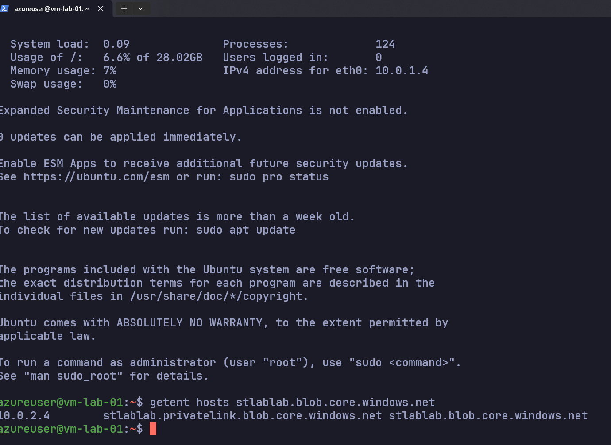
SSH into the VM; private IP 10.0.1.4 confirms it sits in `snet-resources`.

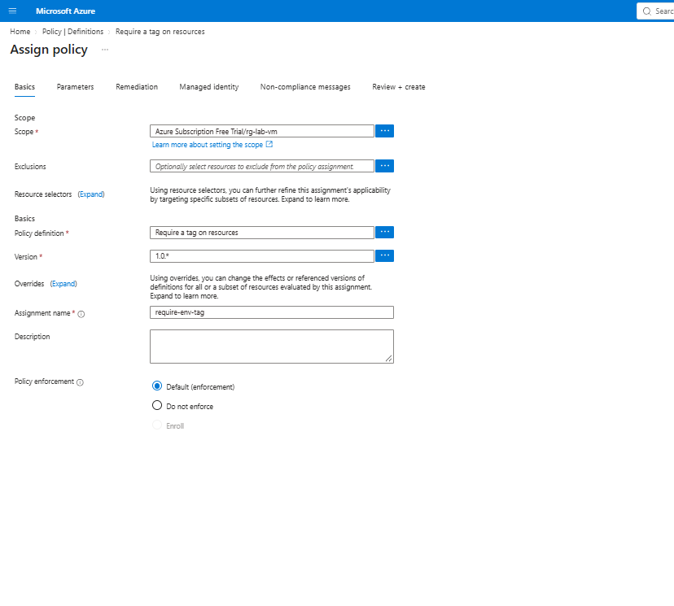
`require-env-tag` assigned to `rg-lab-vm`.

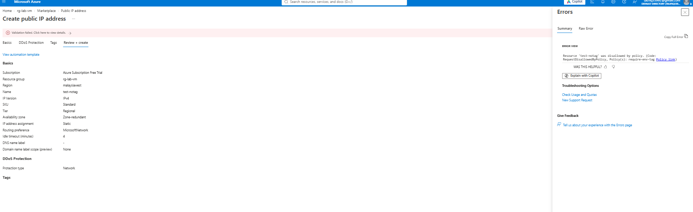
Untagged public IP creation denied by policy.

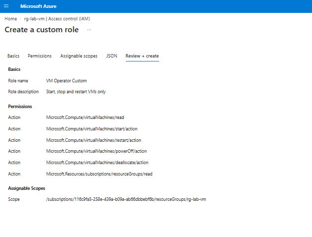
Custom role `VM Operator Custom` with six actions.

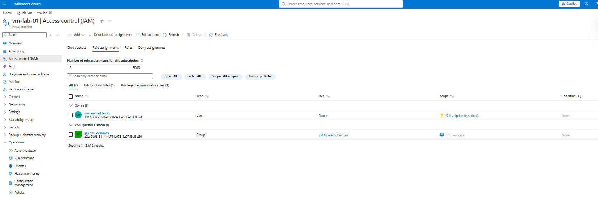
IAM on the VM: group assigned the custom role at VM scope.

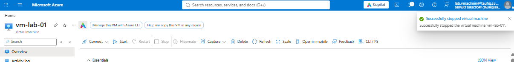
`lab.vmadmin` can stop the VM.

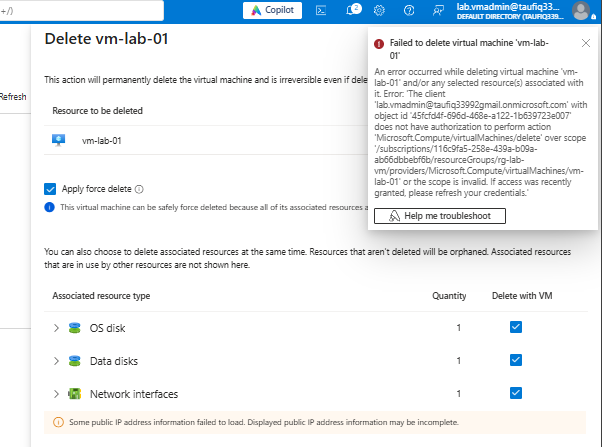
`lab.vmadmin` cannot delete the VM.

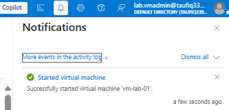
Deletion failure notification.

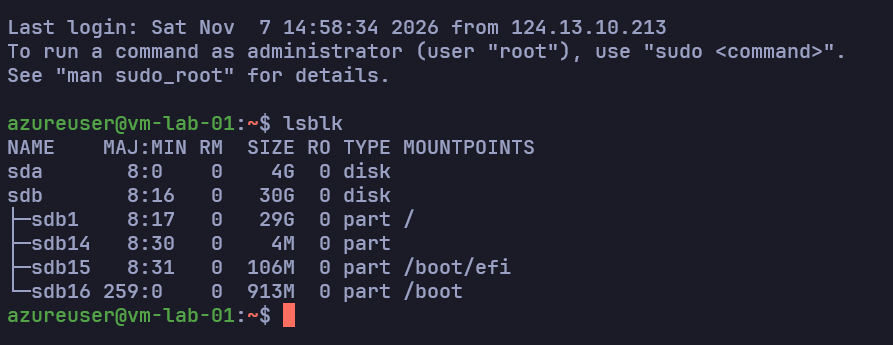
OS disk `sda` and data disk `sdb` with its partitions.

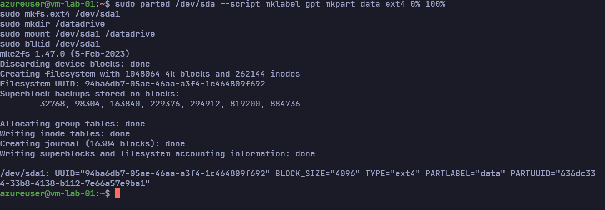
`parted`, `mkfs.ext4`, and `mount` on the data disk.

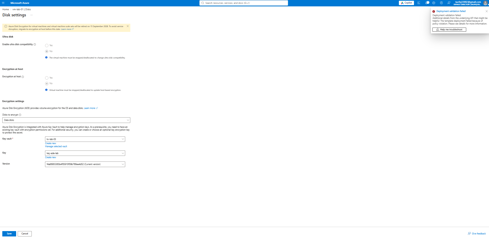
Azure Disk Encryption settings with Key Vault `kv-lab-03`.

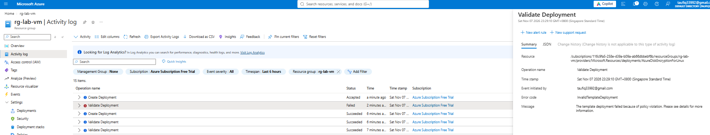
ADE extension deployment failed in the activity log.

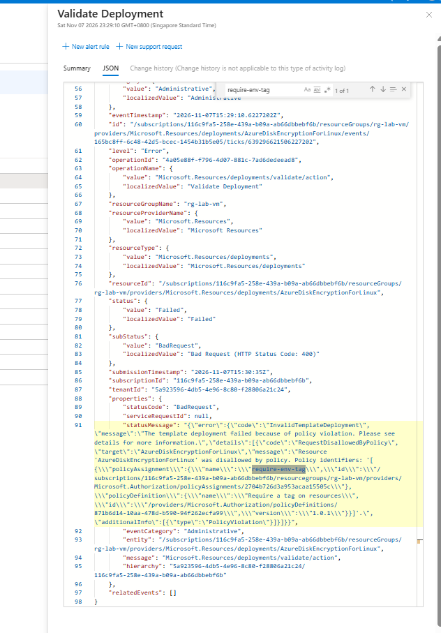
Failure detail: `RequestDisallowedByPolicy` from `require-env-tag`.

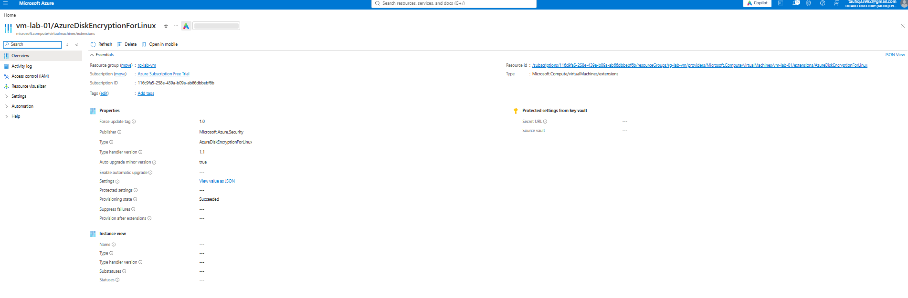
`AzureDiskEncryptionForLinux` extension on the VM.

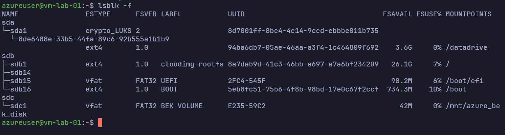
Data partition shows `crypto_LUKS`; BEK volume holds the unlock key.

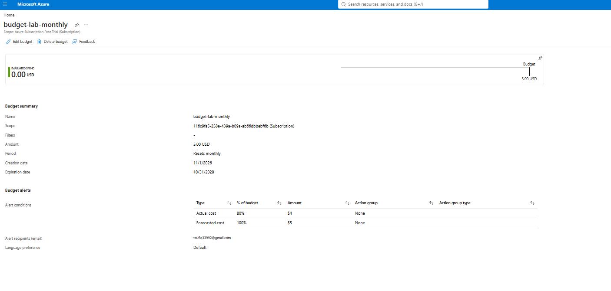
`budget-lab-monthly` with alert thresholds configured.

## Troubleshooting
- **Problem:** ADE failed with `InvalidTemplateDeployment` and `RequestDisallowedByPolicy`
- **Cause:** the ADE extension deployed without an `env` tag, so `require-env-tag` denied it
- **Fix:** set the policy to Do not enforce, enabled ADE, then restored enforcement

## Design notes
- Encrypted the data disk only: Linux OS disk encryption needs more memory than a 4 GiB VM has
- Data disk added to `/etc/fstab` with `nofail` before encryption
- ADE retires on 15 September 2028; encryption at host is the replacement
- Budget scope is the billing account; alerts only notify and do not stop spending
- VM and its NIC, public IP, and disks sit in different resource groups from the VNet

## Exam notes
- Custom role: `Actions`, `NotActions`, `DataActions`, `AssignableScopes`
- Assignments are inherited by child scopes; assign roles to groups
- Policy effects: Deny blocks, Audit flags, Modify can add tags
- Deny policies also block extensions and template deployments
- Budgets alert on actual or forecasted cost and can trigger action groups
