# Azure AZ-104 Lab

Hands-on Azure administration lab built as one connected environment, not six separate demos. Each project reuses what the previous one created, and the full setup can be redeployed from a single template.

## Goals

- Practise the AZ-104 exam domains by building and operating real resources
- Show identity, networking, compute, monitoring, backup, and app hosting working together
- Document each step with screenshots and short explanations

## Architecture

Dashed boxes and edges are planned or in progress.

```mermaid
%%{init: {"theme": "dark"}}%%
flowchart TB
    subgraph ENTRA["Microsoft Entra ID"]
        USERS["Users<br/>lab.vmadmin, lab.webdev, lab.reader"]
        GROUPS["Security groups<br/>grp-vm-operators<br/>grp-webapp-contributors<br/>grp-lab-readers"]
        CA["Conditional Access, MFA<br/>05 - in progress"]
        PIM["PIM and access reviews<br/>05 - in progress"]
        USERS --> GROUPS
    end

    subgraph SUB["Azure subscription - Malaysia West"]
        BUDGET["Budget<br/>budget-lab-monthly<br/>scoped to the billing account"]

        subgraph RGN["rg-lab-network"]
            subgraph VNET["vnet-lab 10.0.0.0/16"]
                SNET1["snet-resources<br/>10.0.1.0/24<br/>nsg-resources"]
                SNET2["snet-privateendpoints<br/>10.0.2.0/24"]
            end
            PE["Private endpoint<br/>pe-stlablab-blob<br/>IP 10.0.2.4"]
            DNS["Private DNS zone<br/>privatelink.blob.core.windows.net"]
            STORAGE["Storage account stlablab<br/>public access disabled"]
        end

        subgraph RGV["rg-lab-vm"]
            POLICY["Azure Policy<br/>require-env-tag"]
            VM["vm-lab-01<br/>Ubuntu 24.04 + data disk"]
            KV["Key Vault<br/>kv-lab-03"]
            DCR["Data collection rule<br/>dcr-lab-vm"]
            LAW["Log Analytics<br/>law-lab"]
            AMETRIC["Metric alert<br/>CPU above 70 percent"]
            ALOG["Log alert<br/>failed SSH logins"]
            AG["Action group<br/>ag-lab-email"]
            RSV["Recovery Services vault<br/>rsv-lab"]
        end

        APP["App Service<br/>slots, autoscale, backup<br/>06 - planned"]
    end

    EMAIL["Email notification"]

    GROUPS -->|"custom role VM Operator Custom"| VM
    CA -.->|"MFA for Azure management"| GROUPS
    PIM -.->|"eligible roles, reviews"| GROUPS
    GROUPS -.->|"Website Contributor"| APP

    VM -->|"NIC"| SNET1
    VM -.->|"resolves stlablab to 10.0.2.4"| DNS
    DNS -.->|"linked to"| VNET
    PE --- SNET2
    PE -->|"registers A record"| DNS
    PE -->|"private link"| STORAGE

    VM -->|"encrypts data disk"| KV
    VM -->|"Azure Monitor Agent"| DCR
    DCR -->|"Perf and Syslog"| LAW
    LAW --> ALOG
    VM -->|"platform metrics"| AMETRIC
    AMETRIC --> AG
    ALOG --> AG
    AG --> EMAIL

    VM -->|"daily backup"| RSV
    RSV -->|"reads keys and secrets"| KV
    POLICY -.->|"requires env tag"| VM
    APP -.->|"diagnostics"| LAW

    classDef ident fill:#4527a0,stroke:#b39ddb,color:#ffffff,stroke-width:2px
    classDef net fill:#0d47a1,stroke:#90caf9,color:#ffffff,stroke-width:2px
    classDef storage fill:#e65100,stroke:#ffb74d,color:#ffffff,stroke-width:2px
    classDef compute fill:#1b5e20,stroke:#a5d6a7,color:#ffffff,stroke-width:2px
    classDef sec fill:#b71c1c,stroke:#ef9a9a,color:#ffffff,stroke-width:2px
    classDef mon fill:#006064,stroke:#80deea,color:#ffffff,stroke-width:2px
    classDef gov fill:#37474f,stroke:#b0bec5,color:#ffffff,stroke-width:2px
    classDef notify fill:#ad1457,stroke:#f48fb1,color:#ffffff,stroke-width:2px
    classDef planned fill:#263238,stroke:#78909c,color:#eceff1,stroke-dasharray: 5 5

    class USERS,GROUPS,CA,PIM ident
    class SNET1,SNET2,PE,DNS net
    class STORAGE storage
    class VM compute
    class KV,POLICY sec
    class DCR,LAW,AMETRIC,ALOG,AG,RSV mon
    class BUDGET gov
    class EMAIL notify
    class CA,PIM,APP planned

    style ENTRA fill:#2a1a5e,stroke:#7e57c2
    style RGN fill:#0b1f3a,stroke:#1565c0
    style VNET fill:#0e2a4f,stroke:#1e88e5
    style RGV fill:#12321d,stroke:#2e7d32
    style SUB fill:#101418,stroke:#546e7a
```



- **Identity:** Entra ID users and groups drive RBAC across every project
- **Network:** one VNet with a resource subnet, a private endpoint subnet, and an NSG
- **Compute:** a VM in the resource subnet, plus an App Service with slots
- **Storage:** `stlablab` with public access disabled, reachable only through `pe-stlablab-blob` at 10.0.2.4
- **Operations:** one Log Analytics workspace, shared alerts, Recovery Services vault
- **Governance:** tag policy and budget alert scoped to the billing account

## Build Order

| Step | Folder | Focus | Status |
|---|---|---|---|
| 1 | [01-entra-users-groups](01-entra-users-groups/) | Users and groups | ✅ |
| 2 | [02-network-storage](02-network-storage/) | VNet, NSG, private endpoint, ARM template | ✅ |
| 3 | [03-vm-rbac](03-vm-rbac/) | VM, custom RBAC role, tag policy, encryption, budget alert | ✅ |
| 4 | [04-monitoring-backup](04-monitoring-backup/) | Alerts, Log Analytics, KQL, VM backup and restore | ✅ |
| 5 | [05-entra-ca-pim](05-entra-ca-pim/) | Conditional Access, PIM, access review, sign-in logs | 🟨 |
| 6 | [06-app-service](06-app-service/) | Slots, zero-downtime swap, autoscale, backup | ⬜ |

## Project Summaries

### 01 – Entra Users and Groups
- Test users and security groups
- Groups used later for RBAC, PIM, and access reviews

### 02 – Network and Storage
- VNet with two subnets (resources, private endpoints)
- NSG with explicit allow rules only
- Storage account with public access off and a private endpoint
- Private DNS zone linked to the VNet
- ARM template to redeploy everything

### 03 – VM and RBAC
- VM placed in the resource subnet from step 2
- Custom RBAC role scoped to the VM
- Azure Policy enforcing required tags
- Disk encryption configured
- Budget alert at a set threshold

### 04 – Monitoring and Backup
- Metric alert (CPU) and log alert (KQL)
- Log Analytics workspace with diagnostic settings
- KQL query for an operational signal
- Recovery Services vault, backup policy, and a verified test restore

### 05 – Entra Conditional Access and PIM
- Conditional Access policy requiring MFA for one app
- PIM with approval-based activation (eligible vs active)
- Access review on the lab groups
- Sign-in log check, also queried in KQL

### 06 – App Service
- S1 plan with production and staging slots
- App deployed from GitHub ([web app repo](https://github.com/your-username/your-webapp-repo))
- Slot swap with zero downtime
- CPU-based and scheduled autoscale rules
- Backup with retention policy

## How the Projects Connect

- Entra groups from step 1 receive roles in steps 3 and 6
- The VM from step 3 sits in the network from step 2
- Step 4 monitors and backs up that VM
- PIM and access reviews in step 5 apply to the same groups and roles
- App Service diagnostics and alerts reuse the step 4 workspace and action group
- `templates/` rebuilds the combined environment

## Repository Structure

```
azure-az104-lab/
├── README.md
├── 01-entra-users-groups/
├── 02-network-storage/
├── 03-vm-rbac/
├── 04-monitoring-backup/
├── 05-entra-ca-pim/
├── 06-app-service/
└── templates/
```

- Each project folder has a `README.md` and a `screenshots/` folder
- Each project README covers what was built, steps, and proof screenshots

## Original Project Mapping

| Folder | Original project |
|---|---|
| 01-entra-users-groups | 4 (part 1) |
| 02-network-storage | 2 |
| 03-vm-rbac | 1 |
| 04-monitoring-backup | 3 |
| 05-entra-ca-pim | 4 (part 2) |
| 06-app-service | 5 |

## Skills Demonstrated

- Entra ID, RBAC, Conditional Access, PIM, access reviews
- Virtual networking, NSGs, private endpoints, private DNS
- VM deployment, disk encryption, Azure Policy, cost management
- Azure Monitor, Log Analytics, KQL, alerting
- Azure Backup and restore
- App Service, deployment slots, autoscaling
- Infrastructure as code with ARM/Bicep

## Notes

- Entra P2 trial needed for PIM and access reviews (started at step 5)
- App Service slots, autoscale, and backup need Standard (S1) or higher
- Resources deleted after each project to control cost
- Subscription IDs, tenant IDs, emails, and public IPs redacted in screenshots
- No secrets committed to the repo
