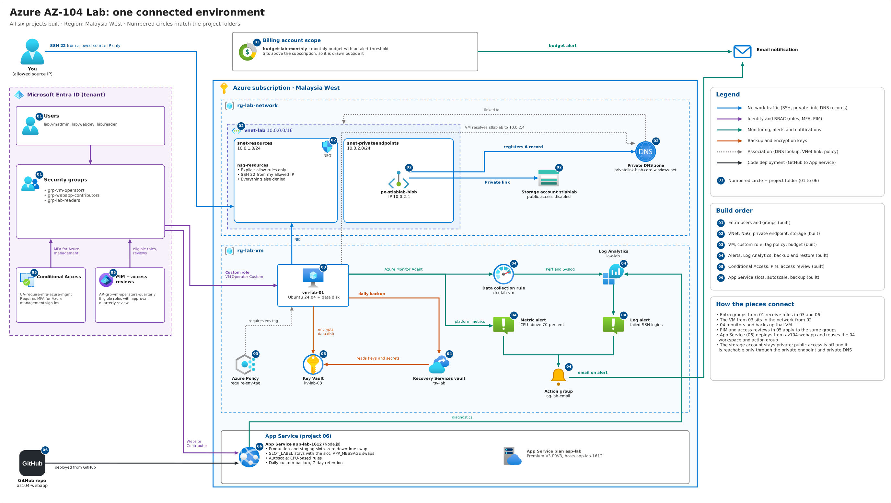

# Azure AZ-104 Lab

Hands-on Azure administration lab built as one connected environment, not six separate demos. Each project reuses what the previous one created, and every step is documented with screenshots.

## Goals

- Practise the AZ-104 exam domains by building and operating real resources
- Show identity, networking, compute, monitoring, backup, and app hosting working together
- Document each step with screenshots and short explanations

## Architecture



- **Identity:** Entra ID users and groups drive RBAC across every project
- **Network:** one VNet with a resource subnet, a private endpoint subnet, and an NSG
- **Compute:** a VM in the resource subnet, plus an App Service with slots
- **Storage:** `stlablab` with public access disabled, reachable only through `pe-stlablab-blob` at 10.0.2.4
- **Operations:** one Log Analytics workspace, shared alerts, Recovery Services vault
- **Governance:** tag policy and budget alert scoped to the billing account

## Build Order

| Step | Folder | Focus | Status |
|---|---|---|---|
| 1 | [01-entra-users-groups](01-entra-users-groups/) | Users and groups | ✅ |
| 2 | [02-network-storage](02-network-storage/) | VNet, NSG, private endpoint, ARM template | ✅ |
| 3 | [03-vm-rbac](03-vm-rbac/) | VM, custom RBAC role, tag policy, encryption, budget alert | ✅ |
| 4 | [04-monitoring-backup](04-monitoring-backup/) | Alerts, Log Analytics, KQL, VM backup and restore | ✅ |
| 5 | [05-entra-ca-pim](05-entra-ca-pim/) | Conditional Access, PIM, access review, sign-in logs | ✅ |
| 6 | [06-app-service](06-app-service/) | Slots, warm-up swap, autoscale, backup | ✅ |

## Project Summaries

### 01 – Entra Users and Groups
- Test users and security groups
- Groups used later for RBAC, PIM, and access reviews

### 02 – Network and Storage
- VNet with two subnets (resources, private endpoints)
- NSG with explicit allow rules only
- Storage account with public access off and a private endpoint
- Private DNS zone linked to the VNet
- ARM template to redeploy everything

### 03 – VM and RBAC
- VM placed in the resource subnet from step 2
- Custom RBAC role scoped to the VM
- Azure Policy enforcing required tags
- Disk encryption configured
- Budget alert at a set threshold

### 04 – Monitoring and Backup
- Metric alert (CPU) and log alert (KQL)
- Log Analytics workspace with diagnostic settings
- KQL query for an operational signal
- Recovery Services vault, backup policy, and a verified test restore

### 05 – Entra Conditional Access and PIM
- Entra ID P2 trial and license assignment
- Conditional Access policy requiring MFA for Azure management
- PIM Security Reader role with approval-based activation
- Access review on `grp-vm-operators`, decided and completed
- Sign-in log check

### 06 – App Service
- Premium V3 P0V3 plan with production and staging slots
- Node.js app deployed from GitHub ([az104-webapp](https://github.com/tttaufiqqq/az104-webapp))
- Slot swap with warm-up, sticky `SLOT_LABEL` vs swapping `APP_MESSAGE`
- CPU-based autoscale rules
- Daily custom backup with 7-day retention

## How the Projects Connect

- The VM operators group from step 1 receives the custom RBAC role in step 3
- The VM from step 3 sits in the network from step 2
- Step 4 monitors and backs up that VM
- PIM in step 5 makes `lab.webdev` eligible for the Security Reader role; the access review applies to `grp-vm-operators`
- The step 6 App Service deploys from [az104-webapp](https://github.com/tttaufiqqq/az104-webapp)
- `02-network-storage/template.json` redeploys the network and storage

## Repository Structure

```
azure-az104-lab/
├── README.md
├── docs/
│   └── architecture.png
├── 01-entra-users-groups/
├── 02-network-storage/
├── 03-vm-rbac/
├── 04-monitoring-backup/
├── 05-entra-ca-pim/
└── 06-app-service/
```

- Each project folder has a `README.md` and a `screenshots/` folder
- Each project README covers what was built, steps, and proof screenshots

## Skills Demonstrated

- Entra ID, RBAC, Conditional Access, PIM, access reviews
- Virtual networking, NSGs, private endpoints, private DNS
- VM deployment, disk encryption, Azure Policy, cost management
- Azure Monitor, Log Analytics, KQL, alerting
- Azure Backup and restore
- App Service, deployment slots, autoscaling
- Infrastructure as code with ARM/Bicep

## Notes

- Entra P2 trial needed for PIM and access reviews (started at step 5)
- App Service slots, autoscale, and backup need Standard or higher (here Premium V3 P0V3; Standard S1 was not offered)
- Resources deleted after each project to control cost
- Subscription IDs, tenant IDs, emails, and public IPs redacted in screenshots
- No secrets committed to the repo
